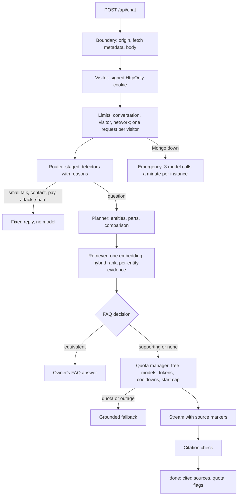

# System Architecture & Technical Specification

This document provides a comprehensive technical overview of the **Dev-Portfolio** software architecture, component tree, data flow, state management, and build optimization pipeline.

---

## 1. High-Level Architecture Overview

```
                      ┌────────────────────────────────────────┐
                      │              USER BROWSER              │
                      │  (Vite + React 18 SPA / Tailwind CSS) │
                      └───────────────────┬────────────────────┘
                                          │
                                HTTP / HTTPS (REST API)
                                          │
                      ┌───────────────────▼────────────────────┐
                      │           NODE.JS BACKEND              │
                      │   (Express, Helmet, Cors, Pino Logs)   │
                      └──────┬──────────┬──────────┬─────────┘
                             │          │          │
                    ┌────────▼───┐ ┌────▼─────┐ ┌──▼──────────┐
                    │  MONGODB   │ │ RAZORPAY │ │BREVO EMAIL  │
                    │Transactions│ │ Checkout │ │SMTP + PDF   │
                    └────────────┘ └──────────┘ └─────────────┘
```

---

## 2. Frontend Architecture Stack

- **Core Library**: React 18 (Concurrent rendering, `useMemo`, `useCallback`, lazy route splitting).
- **Build System**: Vite 5.4 with Rollup code-splitting, manual vendor chunking, and obfuscation.
- **Styling Engine**: Tailwind CSS 3.4 with custom Obsidian design system tokens (`#070708` background, `#c5f82a` toxic accent).
- **Animation Framework**: Framer Motion 12 (`AnimatePresence`, layout animations, spring physics).
- **Command Center**: `cmdk` library powering the `⌘K` Universal Command Center.

---

## 3. Directory Structure

```
src/
├── components/          # Reusable UI components (Navbar, Footer, CommandPalette, LazyImage, TechIcon)
├── context/             # React Context Providers (OpeningContext for splash sequence)
├── data/                # Authoritative Data Stores (projectsData, blogsData, journeyData, servicesData)
├── hooks/               # Custom React Hooks (useAuth, useSEO, use3DTilt, useHeaderHeight)
├── pages/               # Route Page Components (Home, About, Journey, Skills, Projects, Services, Blog)
└── utils/               # Helper utilities (searchEngine, backendPing, analytics)
```

---

## 4. Performance & Image Optimization

- **Multi-Format Image Pipeline**: Responsive AVIF, WebP, and PNG variants generated automatically during build (`scripts/generate-image-variants.js`).
- **Lazy Loading**: Route-based code splitting via `React.lazy()` and `<Suspense>` loaders prevents large bundle payloads.
- **SEO & Metadata**: Dynamic Open Graph, Twitter Cards, and canonical URL management via custom `useSEO()` hook.

---

## 5. Payment Architecture

Paid service pricing is resolved from `backend/data/servicePricing.json`; browser-supplied amounts are ignored. The authenticated API creates a local `PaymentTransaction` before requesting a Razorpay order and returns only safe checkout fields, including the public key ID.

The checkout callback is not treated as proof of payment. `/api/payment/verify` uses the order ID stored in MongoDB for HMAC-SHA256 verification, fetches the payment from Razorpay, and confirms order, paise amount, INR currency, and captured status. `/api/payment/webhook/razorpay` verifies the signature against the exact raw body and records `x-razorpay-event-id` for persistent idempotency.

Both verification paths call one finalizer. It marks the payment paid, upserts one `Booking`, records one activity event, creates a stable receipt identity, and claims email delivery atomically. NodeMailer sends the in-memory PDF through Brevo SMTP; SMTP failure never changes the paid state. Receipt PDFs are generated from trusted MongoDB data and the download endpoint requires authenticated ownership.

---

## 6. Authentication Architecture

The React application exposes one global Google authentication dialog through `AuthContext`. A single loader fetches `https://accounts.google.com/gsi/client`, initializes Google Identity Services once for the backend-provided client ID, and renders Google's official responsive button with FedCM button support. One Tap and automatic account selection are disabled.

`POST /api/auth/google` sends the short-lived Google ID-token credential directly to the backend. The backend verifies signature, issuer, expiration, and the configured audience using `google-auth-library`, then identifies accounts only by the verified Google `sub` stored in the existing `User.googleId` field. The credential is discarded and is never stored or returned.

After reconciliation, the backend issues its own short-lived JWT in the `portfolio_session` HttpOnly cookie. The JWT has a fixed algorithm, issuer, audience, expiration, and unique `jti`; browser JavaScript never receives it. State-changing auth routes require an exact trusted `Origin`, protected application routes resolve `req.authUser` only from the cookie, and payment/activity records retain their existing MongoDB `userId` relationships.

---

## 7. Site Assistant (chat)

The assistant answers questions about Gaurav using only this site's data and the owner's knowledge base (`lib/chat/knowledge-base.json`, D-109). It is a Vercel function, not part of the Render backend: Render's free instance sleeps after 15 idle minutes and takes about a minute to wake. Decisions D-097–D-113; D-113 is the reliability and grounding review.



**Request path** (`POST /api/chat` → `api/chat.js` → `lib/chat/handler.js`)
1. **Validation** (not a public API, D-108):
   - exact `Origin` allow-list (`CHAT_ALLOWED_ORIGINS`, default the production origin)
   - JSON only, body ≤ 4 KB
   - UUID `sessionId`, question ≤ 500 characters
   - at most 2 earlier questions as history; earlier answers are never sent back
2. **Conversation layer** (`intents.js`, D-107): small talk, unsafe input, gibberish and other scripts get fixed replies with no model call; replies change when repeated. The server reads the session's recent turns, so follow-ups ("tell me more", "what stack did it use?", "the hackathon before that") are resolved against the previous answer, and dates are compared in code.
3. **Cleaning:** control characters and chat-template tokens are stripped; emails and phone numbers become `[email]`/`[phone]` (`redact.js`).
4. **Visitor and limits** (`visitor.js`, `store.js`, D-113): a signed HttpOnly cookie identifies an anonymous visitor (not a person: scripts can drop it). Fixed windows in `chat_rate`, all atomic `$inc`:
   - per conversation 18 per 10 minutes and 80 per day; per visitor 30 and 120; per network (salted IP hash, Vercel's own header) 300 per 10 minutes, plus 120 *model calls*;
   - new visitor ids per network capped at 30 an hour, past which they get no model calls;
   - one request at a time per visitor (`chat_locks`, TTL); a parallel one gets a `busy` event.
   Over a limit the stream carries one `limit` event with a retry time.
5. **Retrieval** (`retrieve.js`, `knowledge.js`, D-109):
   - Corpus (`lib/chat/corpus-index.json`, 317 chunks): the site's projects, journey, skills, services, blog sections, status and four overviews, plus the knowledge base's project records, roadmaps, 68 FAQ pairs and profile sections. Every knowledge-base chunk carries its status (documented, planned, user reported, historical), which goes to the model.
   - Hybrid `0.7·cosine + 0.3·BM25`; a project the question names gets a boost; at most 2 chunks per project or section in the context (3 for a named project).
   - FAQ: every FAQ question and alternate phrasing (108 keys) is embedded as a query and matched question-to-question. The owner's answer is sent as written (no model call) only for an equivalent question: exact wording, or cosine ≥ 0.92 with a 0.03 lead over the next FAQ, the same names, the same question type and no extra time or duty cue. Otherwise a match ≥ 0.78 leads the context (D-113).
   - Planner (`plan.js`): a question naming several projects, with several parts, or comparing, gets 2 chunks per named entity and 1 per part, up to 8 chunks and 7,000 characters, sources tagged with their entity. Simple questions use 5 chunks.
   - Vectors are `gemini-embedding-001`, 768 dims, stored as int8. Brute force in memory; there is no vector database.
   - If the query can't be embedded, BM25 and word-overlap FAQ matching run alone behind a rarity-weighted coverage gate.
6. **Generation** (`providers.js`, `prompt.js`):
   - Free-tier models only, in `CHAT_PROVIDER_ORDER` (default Groq `openai/gpt-oss-20b`, then Gemini `gemini-3.5-flash-lite`), then a grounded fallback: the closest FAQ answer, labelled with its question, or else the matched pages.
   - Quota manager (`quota.js`, D-113): requests and tokens per minute and per day are reserved before a call and settled with the provider's reported usage; a 429/503 sets a shared cooldown from the retry hint; at most 6 generations start per 10 seconds site-wide. If MongoDB is unreachable, each instance may make 3 model calls a minute.
   - A provider is skipped on no key, a refused quota, a cooldown, a non-2xx, no first token within 8 s, or a malformed or empty stream; it never switches after the first token, and a cut answer carries `cut` so the client offers a retry.
   - The model cites `[n]`; `cite.js` drops markers that point nowhere, builds the links from the cited sources, and flags numbers or a project's technologies missing from the evidence (a lexical check, not proof).
   - The system prompt fences context and question as data and has fixed decline phrases. A decline drops sources and follow-ups.
7. **Response:** NDJSON, `delta` events then one `done` with at most 3 sources, 3 follow-ups, the visitor's quota (`left`, `limit`, `scope`, `resetAt`), `citations` (marker → source), and `unverified`/`cut` when they apply; a `limit` event says whether the 10-minute or the daily cap was hit; `busy` means a request is already running. Follow-ups are the owner's FAQ questions closest to the answer, picked with maximal marginal relevance and never one already asked; no extra model call.
8. **Storage:**
   - `chat_turns`: redacted question, answer, chunk ids, provider, latency, salted IP hash; TTL 180 days.
   - `chat_cache`: repeated first questions, 24 h, keyed by `CACHE_SCHEMA` and the corpus version.
   - `chat_locks`: per-visitor locks and shared provider cooldowns, TTL.
   - Nothing stored is returned to the client. If MongoDB is unreachable, counters fall back to per-instance memory marked `shared: false` (emergency mode for model calls) and turns are not logged.
   - Freshness: the index version covers every text and name the runtime reads; `npm run build` fails while `corpus-index.json` is stale or the knowledge base is malformed.

**Client** (`src/components/chat/`)
- "Ask" (`ChatTrigger`) sits beside the dock. `ChatSurface` is a lazy chunk fetched on hover, focus or touch, and it injects its own CSS so the global stylesheet doesn't grow.
- Opening it wipes the site into the chat state: the chrome and dock recede, `#main-content` becomes `inert`, and a focus trap applies. Esc stops a stream, then closes; the browser Back closes it.
- The thread is kept in `sessionStorage`, and so is the quota: from 5 questions left a hairline meter shows the count, and once a limit is hit the composer is locked with a countdown until it resets (D-109).
- Answers use a small format (`answerFormat.js`): paragraphs, lists, bold names and links only to site paths and the owner's known profile hosts, parsed to data and rendered without `innerHTML`. Text is revealed at an even pace while it streams.

**Configuration:** every limit and model name is in `lib/chat/config.js`. Environment variables are listed in `docs/DEPLOYMENT.md` ("Site assistant"). Kill switches: `CHAT_ENABLED=0` (API) and `VITE_CHAT_ENABLED=false` (hides the trigger).

**Tests:** `npm run test:chat` runs unit tests, the evaluation datasets in `scripts/chat-eval/` (routing, typos, recruiter, security, multi-part) and reliability tests with a fake MongoDB (providers, the embedder and MongoDB are mocked). `npm run chat:dev` runs the real handler locally on `:8787`; Vite proxies `/api/chat` to it in dev and preview.
